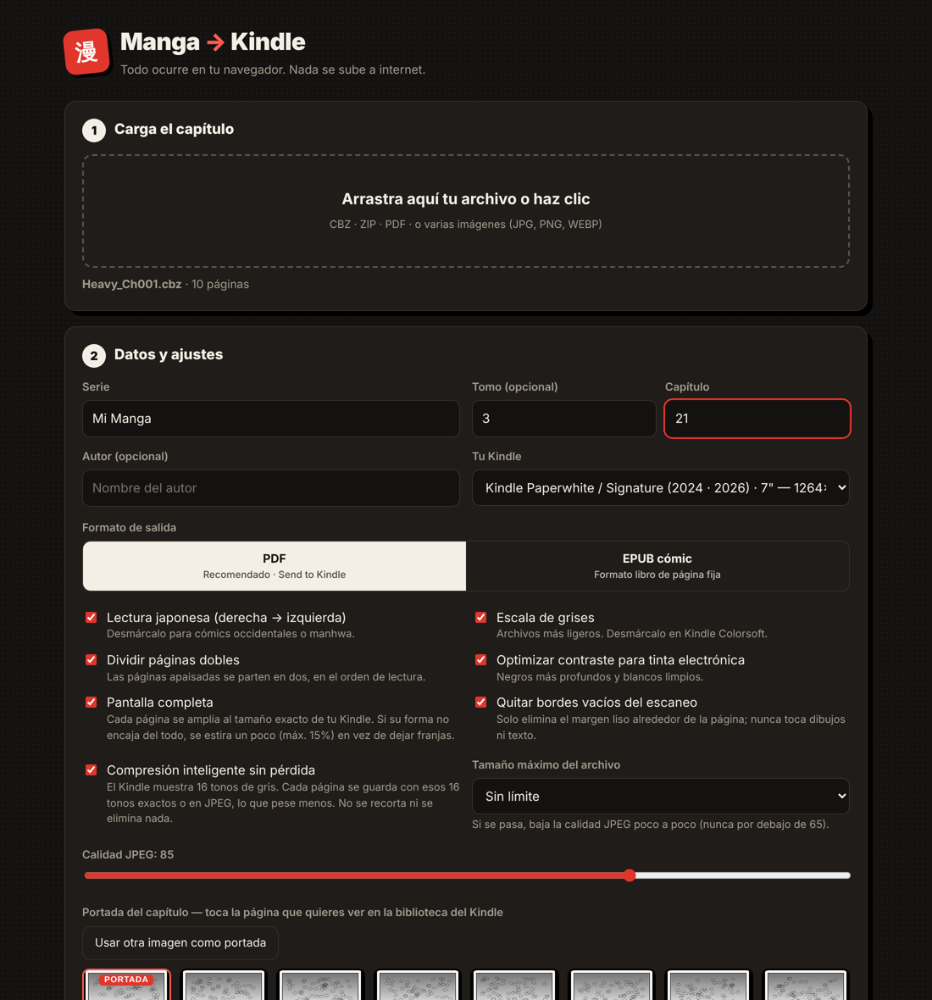

# Manga → Kindle

Convierte capítulos de manga (CBZ, ZIP, PDF o imágenes) en archivos listos para tu Kindle, **directamente en el navegador**. No se instala nada y tus archivos nunca salen de tu ordenador.

**👉 Úsalo aquí:** `https://TU-USUARIO.github.io/manga-a-kindle/`
*(o descarga `index.html` y ábrelo con doble clic; funciona sin internet)*

## Qué hace
- **Pantalla completa:** cada página se genera al tamaño exacto de tu modelo de Kindle y se quitan los bordes vacíos del escaneo.
- **Portada:** eliges qué página aparece como portada en la biblioteca del Kindle.
- **Lectura japonesa:** de derecha a izquierda, con las páginas dobles divididas en el orden correcto.
- **Archivos mucho más ligeros:** se ajusta la resolución y se usa compresión de 16 tonos de gris, sin pérdida y adaptada a la tinta electrónica. Puedes fijar un tamaño máximo (25, 50 o 200 MB).
- **Salida en PDF (recomendado) o EPUB de página fija**, compatibles con Send to Kindle.
- **Modelos:** Paperwhite, Kindle básico, Colorsoft, Oasis, Scribe y modelos antiguos, además de una resolución personalizada.

## Cómo pasarlo al Kindle
1. Convierte el capítulo y descarga el archivo.
2. Súbelo en [amazon.com/sendtokindle](https://www.amazon.com/sendtokindle), o envíalo por correo a tu dirección `@kindle.com` **sin** poner "convert" en el asunto.
3. También puedes copiar el PDF por USB a la carpeta `documents` del Kindle.

## Privacidad
Todo el procesamiento ocurre en tu navegador. La página no hace ninguna petición a internet, no usa cookies ni analítica, y no guarda nada.

## Limitaciones
- Los archivos CBR/CB7 (RAR/7z) no se pueden abrir en el navegador; extráelos primero.

## Aviso
Proyecto independiente, sin relación con Amazon. Kindle es una marca de Amazon.com, Inc.
Úsalo solo con contenido que tengas derecho a usar.

## Licencia
MIT. Incluye [JSZip](https://stuk.github.io/jszip/) (MIT) y [PDF.js](https://mozilla.github.io/pdf.js/) (Apache 2.0); sus licencias están en `third_party/`.
